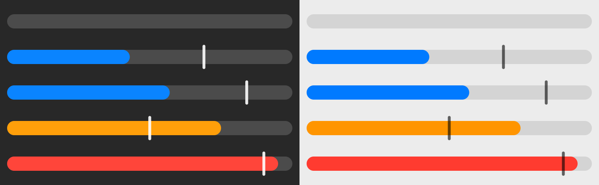

# orca-usage-swiftbar

[Orca](https://github.com/stablyai/orca)에 연결된 AI 제공자 계정의 사용량을 macOS 메뉴바에 보여주는 [SwiftBar](https://swiftbar.app) 플러그인입니다.



## 특징

- **Orca가 단일 기준(SSOT)**: 제공자 API를 직접 부르지 않고 Orca가 가진 값만 보여줍니다.
- **새로고침도 Orca에 요청**: 메뉴의 "↻ 지금 새로고침"이나 자동 새로고침은 Orca가 직접 제공자에서 다시 받아오게 합니다. 그래서 Orca 화면과 메뉴바가 항상 같은 값을 봅니다.
- **제공자별 사용률**: 세션(5시간), 주간, 월간 사용률과 리셋 시각을 보여줍니다. Claude, Codex 외에 GLM Coding Plan(Z.AI·Zhipu)도 Orca에 연결하면 함께 나옵니다.
- **기간 경과 세로선**: 리셋 주기 중 지난 시간을 세로선으로 표시합니다. 막대가 선보다 짧으면 여유 있게 쓰는 중입니다.
- 다크/라이트 모드 지원, 70% 주황 / 90% 빨강 경고

메뉴 예시 (`fixtures/sample.json`):

```
◔ 57·43%
──────────────────────────────────────────────
Claude · you@example.com (Example Org)
[■■■■■■■□□□]  57%  세션 5시간 · 오늘 15:24 리셋 (49분 후)
[■■■■□□□□□□]  43%  주간 · 10/29(목) 19:23 리셋
[■■■■■□□□□□]  48%  주간 · Fable · 10/29(목) 19:23 리셋
OpenCode Go
[□□□□□□□□□□]   0%  세션 5시간 · 오늘 19:35 리셋 (5시간 0분 후)
[□□□□□□□□□□]   0%  주간 · 11/2(월) 14:35 리셋
[■■■■■■■□□□]  67%  월간 · 11/10(화) 14:35 리셋
MiniMax
[■■■■■□□□□□]  47%  세션 5시간 · 오늘 16:14 리셋 (1시간 39분 후)
[□□□□□□□□□□]   4%  주간 · 11/2(월) 02:35 리셋
GLM Coding Plan · Max 플랜
[■□□□□□□□□□]  12%  세션 5시간 · 오늘 15:55 리셋 (1시간 20분 후)
[■■■□□□□□□□]  31%  주간 · 10/31(토) 14:35 리셋
[■□□□□□□□□□]   8%  월간 · MCP · 11/8(일) 14:35 리셋
──────────────────────────────────────────────
미연결 제공자 2개 ▸
갱신 방금 · Orca 기준
↻ 지금 새로고침
Orca 열기
```

## 요구 사항

- macOS (macOS 26에서 확인)
- [Orca](https://github.com/stablyai/orca) 데스크톱 앱이 `/Applications/Orca.app`에 설치돼 있고 실행 중일 것
- SwiftBar (없으면 `install.sh`가 Homebrew로 설치)
- Node는 따로 필요 없습니다. Orca 앱에 들어 있는 런타임으로 실행합니다.

## 설치

```sh
git clone https://github.com/dhkimxx/orca-usage-swiftbar.git
cd orca-usage-swiftbar
./install.sh
```

`install.sh`가 하는 일:

1. Orca와 SwiftBar가 있는지 확인합니다. SwiftBar가 없으면 `brew install --cask swiftbar`로 설치합니다.
2. SwiftBar 플러그인 폴더가 지정돼 있으면 그대로 쓰고, 없으면 `~/.config/swiftbar/plugins`로 지정합니다.
3. 플러그인 폴더에 이 저장소의 `orca-usage.1m.js`를 심볼릭 링크로 연결합니다. 같은 이름의 파일이 이미 있으면 `~/Library/Caches/orca-usage-swiftbar/backup/`으로 옮깁니다.
4. SwiftBar를 실행하거나 플러그인을 다시 읽게 합니다.

여러 번 실행해도 결과는 같습니다.

설치 후 확인할 것:

- Ice, Bartender 같은 메뉴바 정리 앱을 쓰면 새 아이콘이 숨김 영역에 들어갈 수 있습니다.
- 재부팅 후에도 쓰려면 SwiftBar 설정에서 "Launch at Login"을 켜세요.

## 업데이트

```sh
git pull
```

플러그인 폴더에는 링크만 있으므로 다음 실행(최대 1분 뒤)부터 바로 반영됩니다.

## 설정

설정은 SwiftBar 플러그인 변수로 바꿉니다. 값은 SwiftBar가 플러그인 폴더의 `orca-usage.1m.vars.json`에 저장하므로 저장소 파일은 건드리지 않습니다.

| 변수 | 기본값 | 설명 |
|---|---|---|
| `ORCA_USAGE_TITLE` | `claude-both` | 메뉴바 숫자. `claude-both`(세션·주간), `claude-session`, `claude-weekly`, `glm-both`, `glm-session`, `glm-weekly`, `max`(연결된 제공자 전체 중 최고값). 고른 제공자가 연결돼 있지 않으면 `max`처럼 표시 |
| `ORCA_USAGE_AUTO_REFRESH_MINUTES` | `5` | Orca 값이 이 분보다 오래되면 자동으로 새로고침 요청. `0`이면 끔 |
| `ORCA_USAGE_WARN_PERCENT` | `70` | 주황색 경고 기준 (%) |
| `ORCA_USAGE_CRITICAL_PERCENT` | `90` | 빨간색 경고 기준 (%) |
| `ORCA_USAGE_SHOW_PACE` | `true` | 막대에 기간 경과 세로선 표시 |

## GLM Coding Plan 연결

GLM 사용량도 Orca에서 받아옵니다. 플러그인에 키를 넣는 곳은 없고, Orca에 한 번 연결하면 됩니다.

1. Orca 설정 → 계정 → **GLM Coding Plan**에서 요금제 사이트(Z.AI 또는 Zhipu BigModel)를 고릅니다.
2. 그 사이트 콘솔에서 받은 요금제 API 키를 저장합니다. ZCode CLI로 로그인돼 있으면 Orca가 그 설정(`~/.zcode/cli/config.json`)을 대신 읽으므로 이 단계는 건너뛰어도 됩니다.
3. 다음 갱신(최대 1분, 또는 "↻ 지금 새로고침")부터 메뉴에 `GLM Coding Plan` 항목이 나옵니다.

- Orca 내부 이름은 `zcode`이고, 연결 전에는 "미연결 제공자"에 `ZCode Coding Plan credentials are not configured`로 나옵니다.
- 세션·주간은 토큰 한도, `월간 · MCP`는 웹 검색 같은 MCP 도구 호출의 월 한도입니다(Orca 화면의 "매월 MCP").
- 제공자 이름 옆의 요금제 등급(Lite/Pro/Max)은 Z.AI 응답 그대로입니다.
- 메뉴바 숫자를 GLM 기준으로 보려면 `ORCA_USAGE_TITLE`을 `glm-both` 등으로 바꿉니다.

## 동작 방식

```
SwiftBar ─(1분마다)→ orca-usage.1m.js → Orca 런타임 accounts.list
                                          ├ 평소: refreshUsage=false (저장된 값 읽기, 외부 요청 없음)
                                          └ 새로고침: refreshUsage=true (Orca가 제공자에서 받아와 저장)
```

- Orca는 자기 창이 활성화돼 있을 때만 사용량을 스스로 갱신합니다. 그래서 값이 5분 넘게 오래되면 이 플러그인이 Orca에 새로고침을 요청합니다.
- 새로고침 요청은 30초에 한 번까지만 보냅니다(Orca의 최소 갱신 간격과 같음).
- 마지막 새로고침 시각과 실패 내용은 `~/Library/Caches/orca-usage-swiftbar/state.json`에 남깁니다.
- 연결은 Orca CLI가 쓰는 런타임 클라이언트(`/Applications/Orca.app/Contents/Resources/app.asar.unpacked/out/cli/runtime-client.js`)를 그대로 불러 씁니다.

## 개발

```sh
# Orca 없이 가짜 데이터로 메뉴 출력 확인
./orca-usage.1m.js --fixture fixtures/sample.json

# 막대 미리보기 이미지(docs/bars.png) 다시 만들기
ELECTRON_RUN_AS_NODE=1 /Applications/Orca.app/Contents/MacOS/Orca scripts/preview.js
```

## 알려진 제약

| 기대고 있는 것 | 위험 | 깨지면 |
|---|---|---|
| Orca 런타임 명령 `accounts.list`의 `refreshUsage` 옵션 | 공개 CLI 명령이 아닌 내부 기능 | 메뉴에 "새로고침 실패"를 띄우고, 저장된 값은 계속 보여줌 |
| Orca 앱 안의 런타임 클라이언트 경로 | 앱 내부 구조라 업데이트로 바뀔 수 있음 | "Orca 연결 실패" 표시 |
| Orca `zcode` 사용량의 `monthly`가 MCP 월 한도라는 것 | Orca 내부 매핑이라 바뀔 수 있음 | GLM 월간 막대 라벨이 실제와 달라짐 |
| SwiftBar의 `width`/`height` 파라미터 | 문서에 없음. SwiftBar 2.1.1은 macOS 26에서 16pt보다 큰 메뉴 이미지를 줄이는데, 이 파라미터로 원래 크기를 지정함 | 막대가 작게 보임 |

확인한 버전: Orca 1.4.229, SwiftBar 2.1.1, macOS 26.6.2 (GLM Coding Plan 표시는 Orca 1.4.237, macOS 26.6)

## 제거

```sh
./uninstall.sh          # 링크와 상태 파일 제거
./uninstall.sh --purge  # SwiftBar 변수 설정까지 제거
```

## 참고

Orca 공식 도구가 아닙니다. Orca 내부 기능을 쓰기 때문에 Orca 업데이트로 동작이 바뀔 수 있습니다.

## 라이선스

[MIT](LICENSE)
